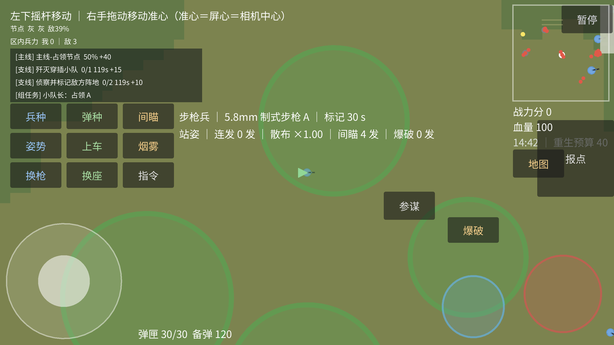
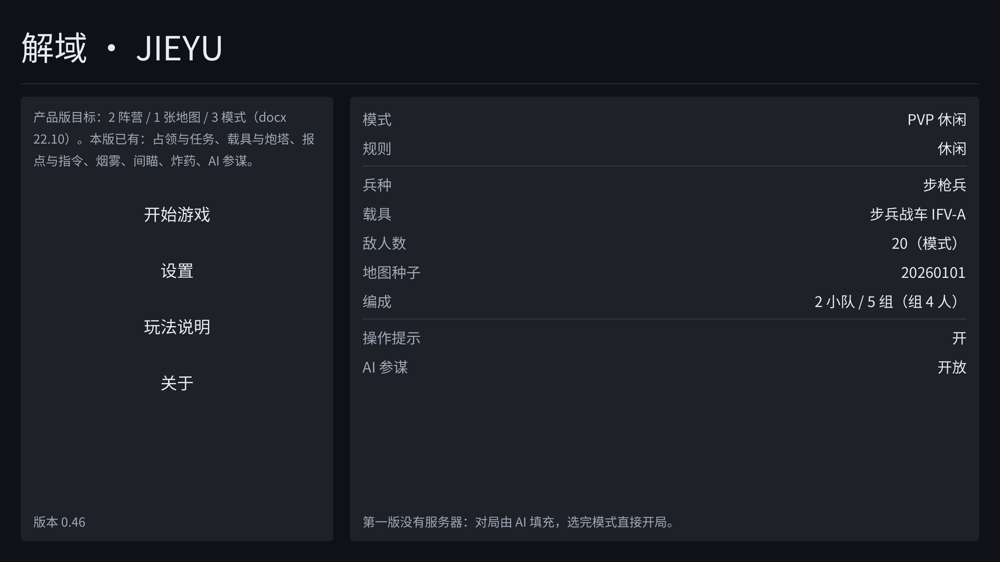
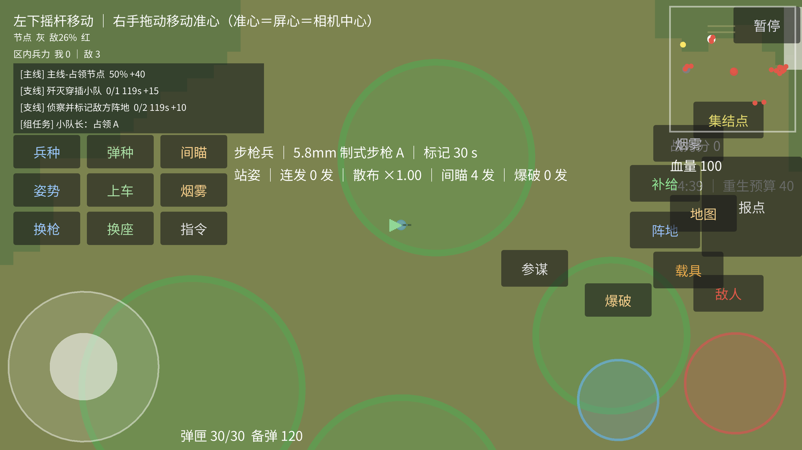

# 解域 · JIEYU

**2D 垂直俯视的 20v20 小队战术射击游戏** ｜ Godot 4.7.1 + GDScript ｜ 已产出 Android 发布包并完成真机验证



## 这是什么

《解域》是一个 2D 垂直俯视的小队战术射击游戏：在 1 km × 1 km 的丘陵草原上，带 2 个小队（5 组 × 4 人）与 20 人规模的敌方争夺五个节点。

- **视角**：正交垂直俯视，固定 90°，屏幕朝北不旋转 —— 不做等轴测、不做斜俯视，地面上没有灭点
- **规模**：单局 15 分钟；五节点 RAAS，白旗点争夺；**第一版没有服务器**，对局由 AI 填充，选完模式直接开局
- **世界**：逻辑画布 960 × 540（16:9），1 m = 32 px；地图 1 km × 1 km，最大海拔 150 m；高度用平面偏移 + 等高线着色做伪 2.5D
- **画面**：矢量风（赛璐璐 / 扁平化 / 硬边）；全局单一光照方向 + 扁椭圆 Blob 阴影
- **已实现**：占领与任务、载具与炮塔、报点与指令、烟雾、间瞄、炸药、AI 参谋

| 大厅 | 报点轮盘 |
|---|---|
|  |  |

更多画面见 [`store/screenshots/`](store/screenshots)（8 张商店用截图）；架构图见 [architecture.html](architecture.html)。

## 工程规模（本机实测）

| 指标 | 数值 | 统计口径 |
|---|---|---|
| GDScript | **205 个文件 / 38,578 行** | 含 `android/`、`.dsh/`；不含 `addons/`、`gdtoolkit/`、`.godot/` |
| 游戏主体 | **198 个文件 / 37,561 行** | 再扣掉 `android/`、`.dsh/` |
| 场景与资源 | 10 个 `.tscn` / `.tres` | 不含 `addons/` |
| 单元测试 | **62 个测试脚本，未全绿 0 个**；断言 2,205 项 | headless，退出码 0 |
| 集成冒烟 | **317 项断言，失败 0** | 实例化 `Main.tscn` 跑全链路 |
| 美术门禁 | 19 项校验，失败 0 | 尺寸 / 命名 / 规格依据 |
| Android 发布包 | 30.3 MB APK | gradle 自定义构建，真机验证 |
| 资产规格 | 98 条（59 图 + 25 动画 + 12 音效 + 2 音乐） | 每条都带「规格依据」，未定 0 条 |

> 行数按 **LF 字节数**统计。中文 UTF-8 文件用 `Get-Content` 数会少数约 6%，所以口径必须写明。

## 跑起来

需要 **Godot 4.7.1**（standard 版）。主场景是 `res://scenes/gameplay/Main.tscn`。

```bash
# 首次导入（生成 .godot/ 缓存）
godot --headless --path . --import

# 单元测试（退出码 0 = 全绿）
godot --headless --path . --script res://tools/run_tests_headless.gd

# 集成冒烟（改了装配 / 交互再跑）
godot --headless --path . --script res://tools/run_integration_headless.gd
```

编辑器里直接打开 `project.godot` 按 F5 即可试玩。Android 出包走
`tools/android_overrides/export_android.ps1`（四步：headless 测试 → 导出 → splash 主题补丁 → `aapt2 badging` 复核），需要 JDK 17。

## 工程结构

| 目录 | 内容 |
|---|---|
| `core/` | 内核与全局常量 |
| `systems/` | 玩法系统（占领、任务、AI、音频、性能等） |
| `entities/` | 单位、载具、特效（如 `entities/effects/BlobShadow.gd`） |
| `ui/` | HUD 与外壳五屏 |
| `scenes/` | 场景装配（主场景 `scenes/gameplay/Main.tscn`） |
| `data/` | 数据表（如 `data/vehicles_data.txt`：各车种长宽高与包络） |
| `assets/` | 美术资产（含 `assets/icons/`，被跟踪的只有实际使用的） |
| `test/` | headless 测试脚本 |
| `tools/` | 测试运行器、出包脚本、提示词生成器 |
| `store/` | 商店素材（8 张截图 + 特色图）与隐私政策成品页 |
| `docs/` | 设计文档与实测记录（见下方索引） |
| `.dsh/skills/` | 本项目的 AI 工作流技能（见下一节） |

## 开发方式：AI 辅助工作流

这个仓库的全部提交集中在 **2026-10-01 ～ 10-11**，其中前 8 天完成 120 次提交、100 个版本抬头。
这不是「手写 100 个版本」，而是**以 AI 辅助工作流推进**的结果 —— 我把方法本身也放进了仓库，因为它是我在这个项目里最主要的工作：

- **`.dsh/skills/`（9 个自研技能）**：真机验证、性能采样、几何门禁、发布工程、资产流水线、进度对账、Android/鸿蒙工具链等，把重复流程固化成可执行脚本，而不是每次重讲一遍
- **验收门禁**：每次提交前跑两套 headless 测试；改 HUD 必须过几何断言（按钮不重叠 / 不出屏 / 点按目标够大）
- **真机验证流程**：装包 → 启动 → 抓 logcat → 截图 → 模拟触摸 → 出结论，证据留档；华为设备「呈现刷新率」用 `dumpsys display` / `SurfaceFlinger --latency` 核对，而不是凭手感
- **`docs/性能预算.md`**：每轮改动的帧时间 / 内存实测与 A/B 决策记录，连「哪次改动没收益、被回滚了」都写在里面
- **`本项目开发进度.txt`**：100 个版本抬头的完整工程日志，每轮写清「做了什么 + 验收数字 + 文档同步」

我在其中的角色是**系统设计、验收标准制定与工程化收口**：把每个系统的输入 / 状态 / 输出 / 边界条件写清楚，落不了地的设计当场改掉或删掉。

## 文档索引

- [本项目开发进度.txt](本项目开发进度.txt) —— 唯一进度入口，100 个版本的完整工程日志
- [docs/性能预算.md](docs/性能预算.md) —— 帧时间与内存的实测与决策记录
- [docs/游戏外壳设计.md](docs/游戏外壳设计.md) —— 五屏外壳与视觉规范
- [docs/美术资产规格.md](docs/美术资产规格.md) —— 98 条资产的规格与依据
- [docs/MVP就绪度.md](docs/MVP就绪度.md) —— 就绪度清单与可复跑的核对命令
- [docs/发布收口.md](docs/发布收口.md) —— 上架前的收口项
- [改动1.md](改动1.md) —— 真机帧率待实施改动清单（P0~P3、预期收益、风险、结果记录区）
- [store/privacy_policy.md](store/privacy_policy.md) —— 隐私政策成品页
- [AGENTS.md](AGENTS.md) —— 本项目的工程约定与历史教训（写给协作 agent 的规则书）

## 许可

代码与美术资产版权归作者所有（**All rights reserved**）。本仓库公开用于作品展示与技术评审，
未授予复制、分发或商用许可。`addons/` 下的第三方插件遵循其各自许可。
