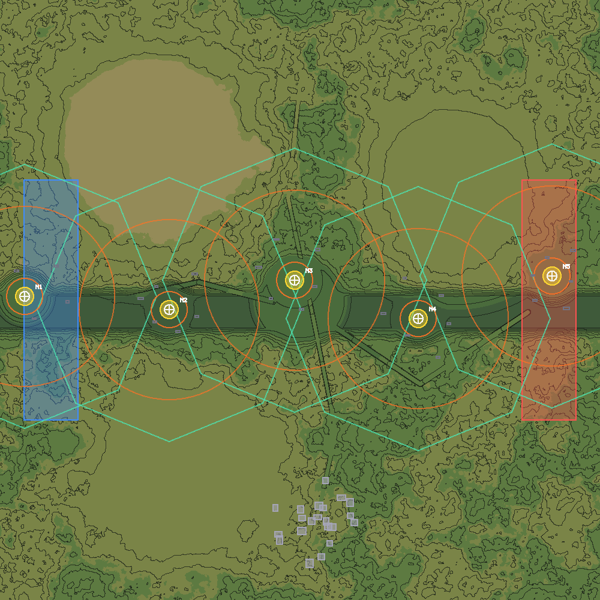

# 解域地图工具链（jieyu_map 插件 + jieyu_map_cli）

> 面向对象：**主要是 agent 自己**（无头批处理），其次是人手点（编辑器 dock）。
> 依据：`squad-2d/解域游戏.docx` 12.8 地图数据规格（确认稿）、12.8.7 JSON 字段定义、
> 第六章地图与场景设计方法论、4.2 白旗点五结构、4.3 判断地图是否失衡的 5 项指标。
> 落地位置：`addons/jieyu_map/`、`tools/jieyu_map_cli.gd`、`test/jieyu_map_test.gd`。

---

## 0. 一句话

**从「一张 1000×1000 灰度图 + 三份 JSON」升级成「可生成、可雕刻、可校验的地图工程」。**

12.8.6 的官方工具链第③步是「PS / GIMP 灰度笔刷压平河道、平整道路、雕刻白旗点周边掩体」——
那一步没有任何可校验的中间态：改完只能靠眼睛看，改错了只能从头再来。
本工具链把这一步搬进工程：同一张高度图、同一份 zones/occluders，
改完立刻能问「坡度能不能走、通视打不打断、节点间距够不够、核心区是不是被建筑堵死了」。

---

## 1. 交付物与目录

```
addons/jieyu_map/
├── plugin.cfg                     编辑器插件注册
├── plugin.gd                      EditorPlugin：把 dock 挂到右侧
├── recipe_demo.json               生成配方示例（cli generate 可直接跑）
├── core/                          纯逻辑，不依赖编辑器（无头可测）
│   ├── JieyuMapSpec.gd            规格常量唯一出口（文档数字只写这里）
│   ├── JieyuMapDoc.gd             地图文档 + 12.8.1/12.8.7 磁盘读写
│   ├── JieyuMapGen.gd             噪声生成 / 自动布点 / 道路规划 / 内容层
│   ├── JieyuMapPainter.gd         画笔与编辑原子操作（压平·抬升·平滑·台地·道路·掩体·节点）
│   ├── JieyuMapChecks.gd          约束校验（六章指标 + 4.2 + 4.3 + 12.8.5⑥）
│   └── JieyuMapRender.gd          审阅贴图（高程着色 + 等高线 + 区域 + 掩体 + 点阵标注）
├── editor/
│   ├── JieyuMapDock.gd            面板：状态 + 所有动作 + UI 组装
│   └── JieyuMapCanvas.gd          画布：显示、坐标换算、笔刷拖拽

tools/jieyu_map_cli.gd             无头 CLI（list / info / render / snapshot / validate / generate）
test/jieyu_map_test.gd             131 项自测（规格往返 / 生成 / 画笔 / 编辑 / 校验 / 落盘 / 面板冒烟）
```

> **插件本身也进无头自测**：`--headless` 下编辑器插件不加载，所以面板代码出错只会「静默少一个 dock」。
> `test/jieyu_map_test.gd` 的最后一段把 dock 与画布直接实例化进场景树跑一遍真实调用链
> （画布坐标换算 → UI 组装 → 五种画笔落笔 → 放节点 / 放建筑 / 删建筑 → 撤销重做 →
> 压平节点 / 重建五结构 → 保存 / 校验 / 重画审阅图），把这类问题在无头就抓出来。

### 1.1 一张地图的产物（12.8.1 + 工程的 res://assets/maps/ 约定）

```
res://assets/maps/<map_id>/
├── heightmap.png      1000×1000 8 位灰度 —— 运行时直接导入（12.8.2）
├── meta.json          12.8.7 meta（含 noise 块，保证可复现）
├── zones.json         12.8.7 zones（raas_nodes / flags / spawn_areas / rally_zones）
├── occluders.json     12.8.7 occluders（多边形 + 高度区间）
├── terrain.png        审阅贴图（按高程分段着色，不参与运行）
├── content.png        可选 · 4.17 环境互动区（按行序排 N 片纯色区域）
├── material.png       可选 · 4.17 地形材质 id 图（0 无 / 1 泥泞 / 2 雪地 / 3 草丛）
└── layers/            工作层草稿（层分离 → 求和 的工作流用）
res://assets/maps/<map_id>_height.png   同时产出一份「单张扁平高度图」，
                                        可直接填进 Main.map_height_image 试跑
```

> **为什么要同时出单张扁平图**：工程现有的 `Main.map_height_image` 吃的是单张 PNG。
> 双份产出让「用工具链做的新图马上能进游戏跑」这件事不需要改任何工程代码。

---

## 2. 无头 CLI（agent 的主入口）

```powershell
$godot = "E:\Godot_v4.7.1-stable_win64.exe\Godot_v4.7.1-stable_win64_console.exe"
$proj  = "D:\Godot4.7_Proj\jieyu-1"

# 列出所有地图
& $godot --headless --path $proj --script res://tools/jieyu_map_cli.gd -- list

# 规格摘要（含 ERROR 级问题）
& $godot --headless --path $proj --script res://tools/jieyu_map_cli.gd -- info --map grassland_demo2

# 按配方生成 + 立刻校验（有 ERROR → 退出码 1）
& $godot --headless --path $proj --script res://tools/jieyu_map_cli.gd -- `
    generate --recipe res://addons/jieyu_map/recipe_demo.json --validate

# 只校验已有地图（--json 给机器读）
& $godot --headless --path $proj --script res://tools/jieyu_map_cli.gd -- validate --map grassland_demo2

# 导出审阅图给 agent 看图（可选图层）
& $godot --headless --path $proj --script res://tools/jieyu_map_cli.gd -- `
    snapshot --map grassland_demo2 --out D:\tmp\map.png --layers zones,occluders,passability
```

退出码：`0` = 成功 / `1` = 失败（配方读不到、地图读不到、校验出 ERROR）。

### 2.1 审阅图长什么样

下面是 `recipe_demo.json` 生成出来的那张图（`snapshot --layers zones,occluders,contours` 的产物）：
黄色圆盘 = 核心占领区（15 m）、橙色双圈 = 外围压制圈（30/150 m）、
白色十字 + 点阵编号 = RAAS 节点、青色多边形 = 集结点可用区、
蓝/红矩形 = 东西两个出生区、灰色小方块 = 掩体与建筑、
深色细线 = 每 10 m 一条等高线。



---

## 3. 编辑器插件（人手的入口）

`项目 → 项目设置 → 插件 → Jieyu Map` 打勾，右侧出现「解域地图」dock：

| 区 | 能干什么 |
|---|---|
| 顶部工具条 | 保存 / 校验 / 重画审阅图 / 撤销 / 重做 / 适配视图 |
| 地图 | 切换已存在的地图、重载、导入说明 |
| 生成 | 面板参数生成草稿（网格 / 种子 / 节点数）、按 `recipe_demo.json` 生成、压平所有节点、重画五结构 |
| 画笔 | 抬升 / 下挖 / 压平 / 平滑 / 台地 / 放节点 / 放建筑 / 删建筑 / **放窗 / 放门 / 删开口** + 各自的参数 |
| 图层 | 等高线 / 节点五结构 / 掩体建筑 / 不可通行 / 百米格网（叠加显示，不影响产物） |
| 校验报告 | 校验结果全文（ERROR / WARN / INFO 三级） |

画布操作：**滚轮缩放**（以光标为锚点）、**中键平移**、**左键画**、右键反向画（下挖 / 删建筑）。
每次落笔前自动压一份高度快照，撤销上限 12 步。

> 面板里「按面板参数生成」限制网格 ≤ 512 —— 1000×1000 的生成 + 逐像素审阅贴图在编辑器里要几秒，
> 真做大图走 CLI（CLI 是同一套 `JieyuMapGen`，结果一致）。

---

## 4. 生成配方（recipe.json）

字段全部可省；省略即用 12.8 的默认口径。完整示例见 `addons/jieyu_map/recipe_demo.json`。

| 字段 | 含义 | 默认 |
|---|---|---|
| `map_id` / `name` / `terrain_type` / `players` | 元数据 | `map_new` / 同 id / `grassland` / 64 |
| `grid_w` / `grid_h` | 网格尺寸 | 1000 × 1000 |
| `seed` | 噪声种子（写进 meta，保证可复现） | `GameConfig.DEFAULT_MAP_SEED` |
| `max_elevation_m` | 最大海拔 | 150 |
| `octaves` / `lacunarity` / `gain` / `layers[]` | 12.8.3 四层 fBm 参数 | 文档示例值 |
| `river_axis` / `water_level_m` / `river_center_ratio` / `river_half_width_m` | 河谷压平 | 无 |
| `roads[] = {name, width_m, max_slope_deg, path[[x,y]…]}` | 道路走廊（沿程坡度受控） | 无 |
| `plateaus[] = {pos, radius_m, peak_m, falloff_m}` | 丘陵 / 台地 | 无 |
| `flatten_areas[] = {pos, radius_m, falloff_m, target_m}` | 任意圆形压平（`target_m<0` = 取圆内均值） | 无 |
| `raas_nodes[] = {id,name,pos}` | 手写节点（给了就不自动布点） | 自动布点 |
| `node_count` | 自动布点数 | 5 |
| `settlement_groups` / `buildings_per_group` | 建筑群数量 / 每组栋数 | `节点数×0.6` / 7 |
| `mud_max_ratio` / `snow_min_ratio` / `grass_max_ratio` | 4.17 内容层判据 | 0.10 / 0.62 / 0.55 |

**自动布点做了什么**（`JieyuMapGen.generate_nodes`）：
① 折线骨架（西侧起点 → 中央枢纽 → 东侧终点，正弦摆动，不落在一条直线上）；
② 按六章 200–500 m 把折线拉到目标间距；③ 按地形平坦度在 ±20% 间距内微调；
④ 迭代间距矫正 + 夹回图内。**产物必然满足 200–500 m**（1000×1000 / 5 节点实测 ≈ 217 m）。

---

## 5. 校验口径（`validate` 到底查什么）

三级：`ERROR`（这条不过这张图不该进对局）/ `WARN`（能跑但会挨骂）/ `INFO`（供人判断）。

| 来源 | 判据 | 级别 |
|---|---|---|
| 12.8.2 | 尺寸不是 1000×1000（`HeightGrid.fill_from_image` 会直接拒绝，不缩放） | WARN |
| 12.8.2 | `max_elevation_m` ≠ `GameConfig.MAX_ELEVATION`（导入时按 150 解码） | WARN |
| 12.8.4 | 节点数 ≠ 5 / 节点在地图外 | WARN / ERROR |
| 六章 | 占领点间距 < 200 m / > 500 m | ERROR / WARN |
| 4.2 | 进入通道 < 2 条（< 3 条提示） | ERROR / WARN |
| 4.2 | 压制圈内径 ≤ 核心半径（主战场被吃掉） | ERROR |
| 4.2 / 4.4 | 续航区最近 < 50 m（心脏长在枪口下）/ 最远 > 300 m | WARN |
| 12.8.7 | `flags` 指向不存在的节点 / 节点没有 flag / 缺 `spawn_offset_m` | ERROR |
| 12.8.7 | 多边形 < 3 顶点 / `h_low > h_top` / 顶点出图 | ERROR |
| 12.8.7 | `destructible: true` 却没有 `hp`（没血量这条规则落不了地） | WARN |
| 破坏规则④ | `damage_profiles` 缺完好/受损/摧毁任一段，或 `height_scale` / `damaged_below_ratio` 越界 | ERROR |
| 破坏规则④ | 摧毁段还写着 `blocks_sight: true`（摧毁后不该再挡视线） | ERROR |
| 破坏规则③ | 摧毁段缺 `rubble` 残痕声明 | WARN |
| 开口（拍板①） | 建筑没有开口 / 开口数 < 2（六章：每个占领点 3 个以上入口·射击窗） | WARN |
| 开口 | `type` 不是 `window` / `door` | ERROR |
| 开口 | 开口没贴在墙面上（悬空的洞，弹道判据形同虚设） | WARN |
| 开口 | `half_size` 非正 / `h_low < 0` / `h_top < h_low` / `h_top` 高过掩体顶 | ERROR |
| 开口 | 窗但窗台高为 0（等于落地窗 / 门） | WARN |
| 命名口径 | 地名重复 | ERROR |
| 命名口径 | 地名 > 6 字符 / 节点没名字 | WARN / INFO |
| 六章铁律 | 遮挡体落在核心占领区内 | ERROR |
| 六章 | 遮挡体间距 < 5 m（穿模 + 堵死枪线） | WARN |
| 12.8.5⑤ | 节点核心格坡度 > 30° | ERROR |
| 12.8.5⑤ | 不可通行面积占比 > 45% | WARN |
| 六章 | 最长无掩体可通行直线 > 300 m | WARN |
| 六章 | 相邻节点连线最长无遮挡段 > 200 m | WARN |
| 4.3②/12.8.4 | 存在制高点覆盖 > 2 个节点核心区 | WARN |
| 未做 | 侧翼绕后路径长度比（要 nav.json / NavigationRegion2D） | INFO |

**验证器本身的口径**：通视用「1 m 网格双线性采样 + `SIGHT_MARGIN` 0.3 m + 眼高 1.6 m」，
与工程 `SightSystem` 同一条判据；掩体层用「有掩体采样格」近似（含 5 m 缓冲）。
制高点扫描用**播撒式可见集**（一条射线维护已见最大仰角），不是逐格投线——
后者在 1000×1000 上实测 4.5 分钟，前者 0.3 秒（同一张图）。

---

## 5.1 破坏规则：地图数据里怎么写「打烂之后会怎样」

2026-10-03 拍的板（完整口径见《地图数据规格补充》三点六），落到 `occluders.json` 的每条上：

```json
{
  "id": "building_03", "type": "building",
  "polygon": [[300, 300], [340, 300], [340, 340], [300, 340]],
  "h_low": 0.0, "h_top": 4.6,
  "destructible": true, "hp": 1200,
  "damage_profiles": [
    { "state": "intact",    "damaged_below_ratio": 0.70, "height_scale": 1.00, "blocks_sight": true },
    { "state": "damaged",   "damaged_below_ratio": 0.00, "height_scale": 0.60, "blocks_sight": true },
    { "state": "destroyed", "damaged_below_ratio": -1.0, "height_scale": 0.00, "blocks_sight": false,
      "rubble": { "material_id": 4, "radius_scale": 1.25, "speed_scale": 0.70 } }
  ]
}
```

| 字段 | 含义 |
|---|---|
| `hp` | 结构值。建筑按占地分三档（< 60 m² = 800 小屋 / < 200 m² = **1200 标准** / ≥ 200 m² = 3000 加固）；沙袋类半高墙固定 200 |
| `damage_profiles[].damaged_below_ratio` | 耐久比掉到这条线以下就进这一段（`-1` = 已摧毁） |
| `damage_profiles[].height_scale` | 这一段的顶高 = 完好 `h_top` × 这个系数（受损变矮、摧毁归零） |
| `damage_profiles[].blocks_sight` | 这一段还算不算遮挡体（摧毁段必须 `false`） |
| `damage_profiles[].rubble` | 摧毁后落的贴地残痕（`material_id` 4 / 半径系数 / 移速倍率） |

**伤害谁给**：伤害不在 `occluders.json` 里，而在武器表——
`data/weapons_data.txt` 的 `structure_damage` 列、`data/vehicles_data.txt` 的
`gun_structure_damage` / `atgm_structure_damage` 列。
普通子弹恒为 0，重机枪 30、机炮 35–50、主炮 280、榴弹炮 420、单兵火箭 600、反坦克导弹 800。
> 一栋标准建筑（1200）要 4–5 发主炮或 2 发火箭；步枪打一天也拆不掉一栋楼——
> 这条差异是**有意的**，它决定了「谁有资格改变地图」。

## 6. 常用起手式

```powershell
# ① 生成一张符合规格的 1 km 图并校验（约 20 s）
& $godot --headless --path $proj --script res://tools/jieyu_map_cli.gd -- `
    generate --recipe res://addons/jieyu_map/recipe_demo.json --validate

# ② 自己写一份配方（改 map_id / seed / 节点位置 / 建筑群数量）再生成
#    配方最小形态就是 {"map_id":"my_map","seed":12345}

# ③ 导出审阅图看一眼（agent 用 read_image 看这张）
& $godot --headless --path $proj --script res://tools/jieyu_map_cli.gd -- `
    snapshot --map my_map --out D:\Godot4.7_Proj\_dsh_tmp\my_map.png --layers zones,occluders

# ④ 想直接进游戏跑：把 Main 的 map_height_image 指向
#    res://assets/maps/my_map_height.png（或用目录版的 heightmap.png）
```

---

## 7. 已知边界

- **高度是 8 位**（12.8.2 确认稿）：1 灰度 ≈ 0.59 m。所以
  ① 相邻两格的坡度没有意义（一个量化台阶就是 30.5°），量坡度必须跨 ≥ 10 m；
  ② 比 0.59 m 更细的台阶（城市多层）要另外走 `occluders.json`，不能指望高度图。
- **河谷不是水**：12.8 没有水体层，`water_level_m` 只是把高度压到某个值，
  视觉与是否可通行由内容层 / 后续版本决定。
- **侧翼路径长度比未校验**（需要导航数据）。
- **内容层（4.17）目前是「图上标出来」**：工程侧还没有读 `content.png` / `material.png` 的代码
  （见 `docs/地图数据规格补充.md` 第二节）。
- **工作层（`layers/`）只出草稿**，不做自动求和。
